# JD-Xi Studio

<p align="center">
  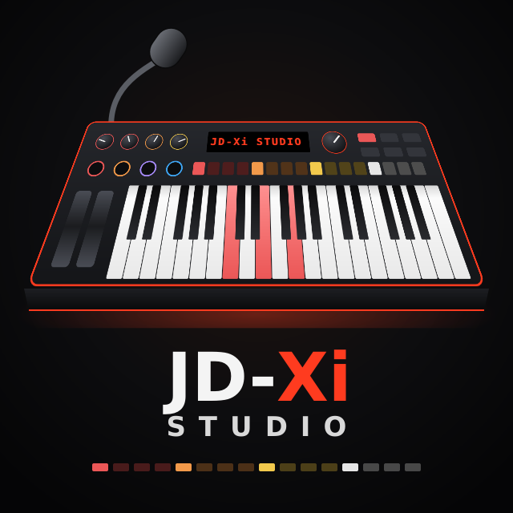
</p>

**JD-Xi Studio** is an editor and librarian for the **Roland JD-Xi** synthesizer: every sound, the
pattern sequencer, the effects and the vocoder, on the computer screen instead of the JD-Xi's menus.

> JD-Xi Studio is developed by **Emanuele Merlo**. It is an independent edition of
> [JDXI-Editor](https://github.com/markxbrooks/JDXI-Editor) by **Mark Brooks**, on which it is based
> (MIT licence). It goes its own way: a new interface for desktop screens with every parameter of
> Roland's manuals, presets and SysEx addresses checked against those manuals, offline mode (no JD-Xi
> needed), English and Italian, and Windows builds from CI. Releases, issues and the app's update
> check use [this repository](https://github.com/emanuelemerlo/JD-Xi-Studio).

<p align="center">
  <a href="resources/keyboard_window.png">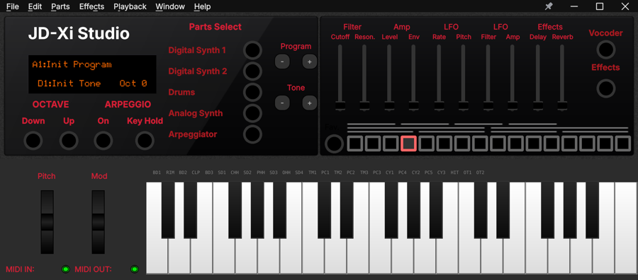</a>
</p>

## ✨ Features

- **Keyboard window** laid out as the instrument: part select, program and tone, octave, arpeggio,
  the panel's sliders and the 37 keys; keep it in front of the other windows with the pin.
- **Digital Synth 1 and 2**: every SuperNATURAL parameter, the three partials with drawn waveforms,
  filter curves, envelopes and LFOs.
- **Analog Synth**: all 46 parameters on one page, the filter curve and envelopes to drag.
- **Drum Kit**: the 37 drum partials as pads, each with its four waves, pitch, filter and amplifier
  envelopes.
- **Effects** (Effect 1, Effect 2, Delay, Reverb, with the signal chain) and **Vocal FX** (Vocoder,
  Auto Pitch).
- **Arpeggio** with its timing drawn and the parts it plays.
- **Programs on one page**: library with search, genre and banks A–H, the parts of the program, the
  mixer; presets, user programs and playlists.
- **Pattern sequencer**: four parts × 16 steps, measures, copy and paste, MIDI files, USB recording.
- **MIDI file player**: track classification, channel assignment, automation; plays on the JD-Xi or
  with FluidSynth and a SoundFont, without hardware.
- **Recipes**: import a sound recipe (template .xlsx/.csv, Markdown, text, PDF or a pasted table) and
  follow it step by step with the JD-Xi's values beside the recipe's.
- **Settings**: the JD-Xi's system settings, the MIDI connection, files and tools.
- **Parameter panel**: point at a control to read its name on the display, its range and what it
  does, with the page of Roland's Parameter Guide.
- **Offline mode**: opens and edits without a JD-Xi or a MIDI system; it connects when one is there.
- **Languages**: English and Italian.

## 🎹 Screenshots

| | |
|---|---|
| **Digital Synth** <br> <a href="resources/digital_synth.png">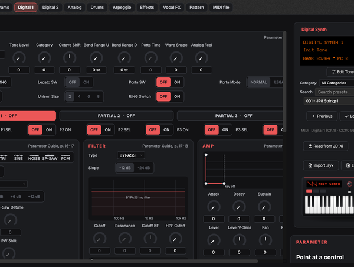</a> | **Analog Synth** <br> <a href="resources/analog_synth.png">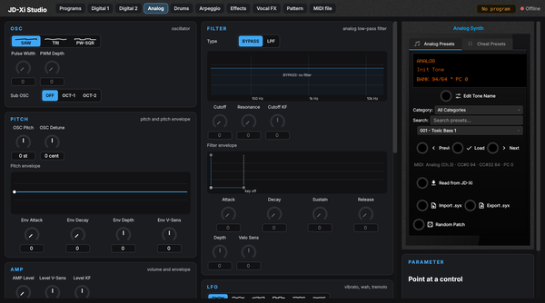</a> |
| **Drum Kit** <br> <a href="resources/drum_editor.png">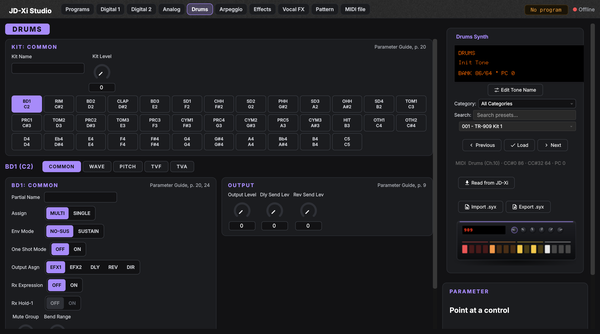</a> | **Programs** <br> <a href="resources/programs_page.png">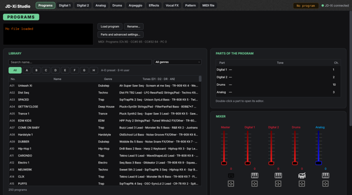</a> |
| **Effects** <br> <a href="resources/effects.png">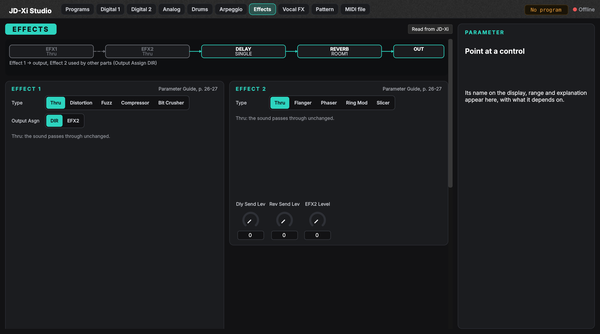</a> | **Vocal FX** <br> <a href="resources/vocal_effects.png">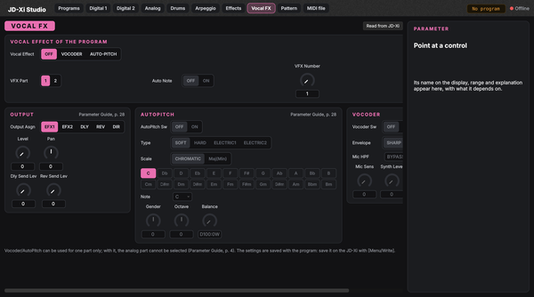</a> |
| **Pattern** <br> <a href="resources/pattern.png">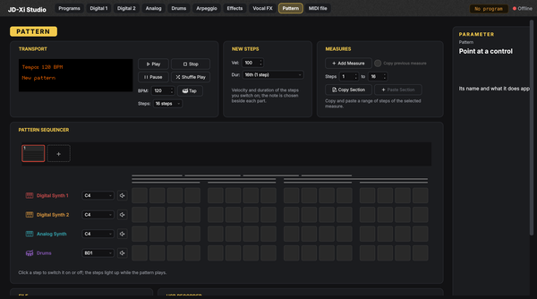</a> | **MIDI file player** <br> <a href="resources/midi_player.png">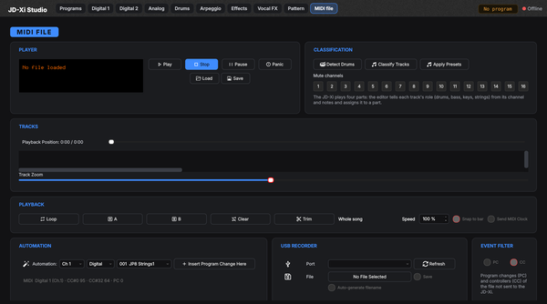</a> |
| **Arpeggio** <br> <a href="resources/arpeggiator.png">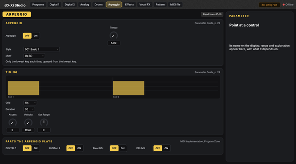</a> | **MIDI connection** <br> <a href="resources/midi_config.png">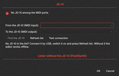</a> |

## 🚀 Download and install

The builds are on the [releases page](https://github.com/emanuelemerlo/JD-Xi-Studio/releases).
Alpha and beta versions are marked as pre-releases. The app checks that page for updates
(Help › Check for Updates).

### Windows 📦
Each release offers two downloads; take the one you want:
- the **installer** `jdxi_editor-<version>_setup_win_x86-64.exe` (installs for the current user,
  no administrator rights, adds Start menu entries and an uninstaller);
- the **portable** `JDXI-Editor-<version>-win64-portable.zip` (nothing to install: unzip anywhere,
  even on a USB stick, and run `jdxi_editor.exe`).

Windows 10 or 11, 64-bit. The files are not signed yet: if SmartScreen warns, choose
"More info" → "Run anyway".

### macOS and Linux
No packages yet: install it with Python (below), or build a package with `python -m building.buildsys`
(see [Building](#-building)).

### Python 🐍
Python 3.10 to 3.13, in a virtual environment. Each release also carries the wheel; or install
from GitHub, and start it with `jdxi-editor`:

```bash
python -m venv jdxi-env
source jdxi-env/bin/activate          # Windows: jdxi-env\Scripts\activate
python -m pip install "git+https://github.com/emanuelemerlo/JD-Xi-Studio.git"
jdxi-editor
```

The `JDXI-Editor` package on PyPI is the original project, not this one.
PyAudio needs the PortAudio library (macOS `brew install portaudio`, Debian/Ubuntu
`sudo apt install portaudio19-dev`) before the `pip install`; the FluidSynth player needs FluidSynth
(`brew install fluid-synth`, `sudo apt install fluidsynth`).

## 🌍 Languages

The interface is in **English** and **Italiano**: choose it in **Help › Preferences › Interface
language** ("Same as the system" follows the operating system; the change applies at the next start).
Parameter names (Cutoff, Resonance, Porta Time…) stay as on the JD-Xi's display and in Roland's
manuals, so what you read matches the instrument. To add a language, see
[jdxi_editor/i18n/README.md](jdxi_editor/i18n/README.md).

## 📖 Documentation

- [CHANGELOG.md](CHANGELOG.md): what changed in each version.
- [Features and usage](doc/features-and-usage.md): patch files (.jsz, .msz, .json, .syx), SoundFonts.
- [Windows development](doc/dev-windows.md): Visual Studio, VS Code, local builds.
- [Developer tools](doc/dev-tools.md): MIDI analysis and transcription tools.
- The original project's documentation, which still describes the engine:
  https://markxbrooks.github.io/JDXI-Editor/

## 🛠 Development

```bash
git clone https://github.com/emanuelemerlo/JD-Xi-Studio.git
cd JD-Xi-Studio
python -m venv venv
source venv/bin/activate              # Windows: venv\Scripts\activate
python -m pip install -e ".[dev]"
python -m jdxi_editor.main
```

Tests: `pytest tests` (Qt runs off screen with `QT_QPA_PLATFORM=offscreen`).
`python scripts/ui_audit.py` checks the interface without clicking every control (navigation,
buttons lit, text that does not fit, labels not centred). After changing interface strings run
`python -m building.i18n update`, translate the `.ts` files, then `python -m building.i18n compile`.
The pictures and icons are drawn by `python building/art/make_art.py`.

## 📦 Building

Windows: the app (PyInstaller, one folder) and the installer (Inno Setup 6):
```commandline
python -m pip install ".[soundfont,build-windows]"   # not -e: the spec bundles the installed resources
cd %TEMP%
pyinstaller --noconfirm --clean --distpath <repo>\dist <repo>\building\windows\jdxi_editor.spec
cd <repo>
iscc /DMyAppVersion=<version> jdxi_editor.iss        # -> dist\installer\
```

macOS (`--dmg`, `--app`, `--pkg`) and Linux (.deb and AppImage): `python -m building.buildsys`.

### Releasing

1. Set the version in `jdxi_editor/project.py` (`__version__ = "1.0.0a2"`, PEP 440) and add its
   section to `CHANGELOG.md`; merge into `main`.
2. **Actions › Release › Run workflow** on `main`. The workflow runs the tests, builds the Windows
   installer, the portable app and the Python wheel, creates the tag (`v1.0.0-alpha.2`) and the
   release (a pre-release for alpha, beta and rc), attaches every file and publishes it.

No tag to push by hand. The `Windows build` workflow still builds every push to `fix/**`,
`feature/**` and `release/**` branches (artifacts at the bottom of the run).

## 🙏 Credits

- **Emanuele Merlo**: JD-Xi Studio.
- **Mark Brooks**: the original [JDXI-Editor](https://github.com/markxbrooks/JDXI-Editor), on which
  JD-Xi Studio is based.
- [Qt / PySide6](https://www.qt.io/), [Mido](https://mido.readthedocs.io/),
  [RtMidi](https://www.music.mcgill.ca/~gary/rtmidi/), [qtawesome](https://github.com/spyder-ide/qtawesome).
- **Roland**, for such a powerful little synth.

Issues and ideas: [GitHub Issues](https://github.com/emanuelemerlo/JD-Xi-Studio/issues).

---

JD-Xi Studio is an independent, unofficial tool, not affiliated with, endorsed or sponsored by Roland
Corporation. Roland and JD-Xi are trademarks of Roland Corporation in the United States and/or other
countries. Licensed under the [MIT License](LICENSE).
