# JD-Xi Studio

<p align="center">
  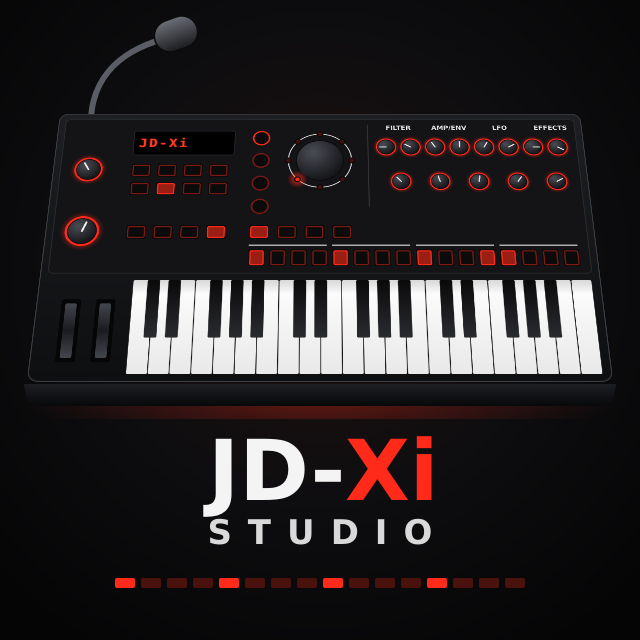
</p>

**JD-Xi Studio — Visual Sound Design, Editing & Librarian for the Roland JD-Xi.**

See the sound you are shaping, edit every parameter of the **Roland JD-Xi** synthesizer — every
tone, the pattern sequencer, the effects and the vocoder — and keep your programs organised, on the
computer screen instead of the JD-Xi's menus.

> JD-Xi Studio is developed by **Emanuele Merlo**. It is an independent edition of
> [JDXI-Editor](https://github.com/markxbrooks/JDXI-Editor) by **Mark Brooks**, on which it is based
> (MIT licence). It goes its own way: a new interface for desktop screens with every parameter of
> Roland's manuals, presets and SysEx addresses checked against those manuals, offline mode (no JD-Xi
> needed), English and Italian, a Windows installer, a macOS disk image and a Linux .deb built by CI. Releases, issues and the app's update
> check use [this repository](https://github.com/emanuelemerlo/JD-Xi-Studio).

<p align="center">
  <a href="resources/keyboard_window.png">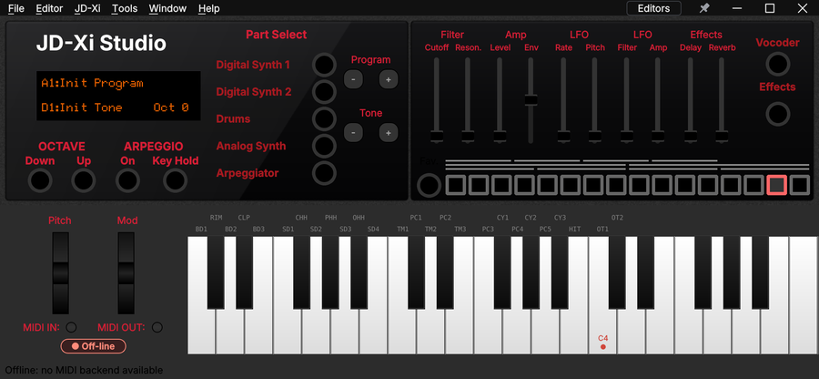</a>
</p>

## ✨ Features

- **Keyboard window** laid out as the instrument: part select, program and tone, octave, arpeggio,
  the panel's sliders and the 37 keys; keep it in front of the other windows with the pin.
- **Digital Synth 1 and 2**: every SuperNATURAL parameter, the three partials with drawn waveforms,
  filter curves, envelopes and LFOs.
- **Analog Synth**: all 46 parameters on one page, the filter curve and envelopes to drag.
- **Drum Kit**: the 37 drum partials as pads, each with its four waves, pitch, filter and amplifier
  envelopes.
- **Effects** (Effect 1, Effect 2, Delay, Reverb, with the signal chain) and **Vocal FX** (Vocoder,
  Auto Pitch).
- **Arpeggio** with its timing drawn and the parts it plays.
- **Programs on one page**: a library that searches number, name, genre and tones, sorts, and marks
  the program loaded; the parts inside the mixer (pan, delay and reverb sends, tone, channel, Edit) in
  their tabs' colours; **Program settings** for everything else the program keeps, part by part;
  playlists; **Save on the JD-Xi**, guided (name, slot, WRITE) and checked by reading the slot back.
- **New sound** in the Digital and Analog editors: from scratch (Init, one Undo), from a preset or
  from a recipe; a **«?»** on each section says what it changes, how the sound changes, an example.
- **A/B compare** (Digital 1, Digital 2, Analog): two photos of a tone, recalled and checked.
- **Where you are**: a line under each editor says program › part › tone, where the sound came from
  and whether it is original, modified and temporary, saved to a file or saved in the JD-Xi.
- **Pattern sequencer**: four parts × 16 steps, measures, copy and paste, MIDI files, USB recording.
- **MIDI Player**: says which tracks the JD-Xi plays and fits them to its four parts; plays on the
  JD-Xi, records its USB audio on every Play; a ruler in the file's own bars and time signatures,
  and one part's notes lit on the keyboard window.
- **Recipes**: describe a sound, let an AI write the recipe (JD-Xi Studio prepares the request
  with the parameters it may set), import its answer — every row checked — and follow it step by
  step on the JD-Xi, then fine-tune by ear. A library with search and categories, an editor by
  steps; also from the template (.xlsx/.csv), Markdown, text or PDF.
- **Settings**: the JD-Xi's system settings, the MIDI connection, files and tools.
- **Undo, Redo and Reload** in every editor (Ctrl+Z / Ctrl+Y, a drag is one step), a pencil on
  the tab of a modified editor and a question before unsaved changes are lost to a preset, a program, a patch or closing.
- **From 1080p to 4K**: a compact layout on low screens (1080p at 125%), the text the same size.
- **Log viewer** with a tab for warnings and errors; the logs are kept two weeks.
- **Follows the JD-Xi**: it reads the instrument at start and every two seconds, so a tone or an
  octave chosen on the JD-Xi shows in the window, the panel sliders show the tone's values, the
  keys light as you play and the window selects the part you are playing.
- **Self-test with the JD-Xi** (JD-Xi menu): the app runs the usual operations on the instrument —
  programs, tones, edits and Undo, octave, notes — checks each result and saves a report.
- **Parameter panel**: point at a control to read its name on the display, its range and what it
  does, with the page of Roland's Parameter Guide.
- **Connection you can trust**: the JD-Xi counts as connected only once it answers as a JD-Xi.
  Without it, an «Off-line» badge in every window, the commands that need it off with the reason,
  and the changes made meanwhile can be saved as a file when it arrives. When it comes back after a
  disconnection, the app compares what it holds with before and offers to restore what differs.
- **Languages**: English and Italian.

## 🎹 Screenshots

| | |
|---|---|
| **Digital Synth** <br> <a href="resources/digital_synth.png">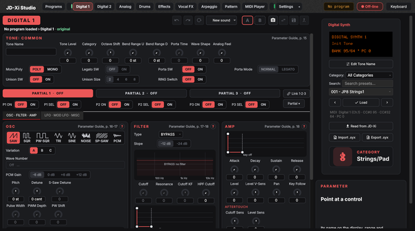</a> | **Analog Synth** <br> <a href="resources/analog_synth.png">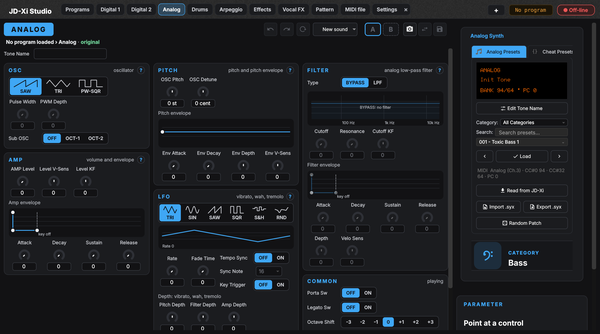</a> |
| **Drum Kit** <br> <a href="resources/drum_editor.png">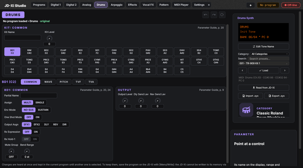</a> | **Programs** <br> <a href="resources/programs_page.png">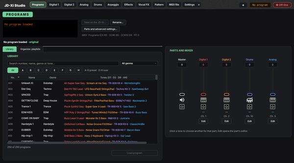</a> |
| **Effects** <br> <a href="resources/effects.png">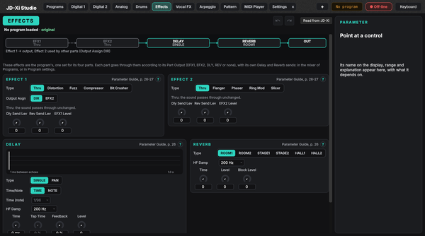</a> | **Vocal FX** <br> <a href="resources/vocal_effects.png">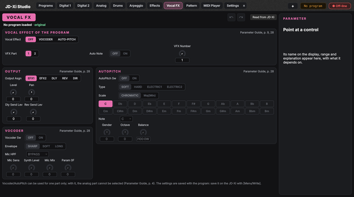</a> |
| **Pattern** <br> <a href="resources/pattern.png">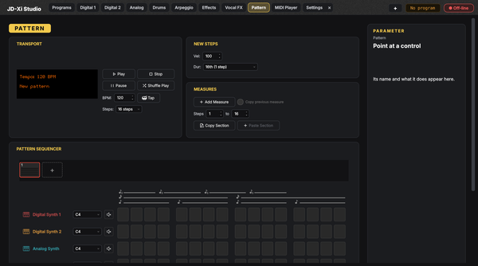</a> | **MIDI Player** <br> <a href="resources/midi_player.png">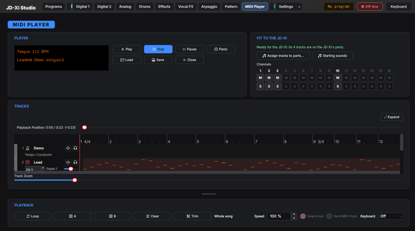</a> |
| **Arpeggio** <br> <a href="resources/arpeggiator.png">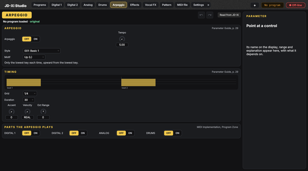</a> | **MIDI connection** <br> <a href="resources/midi_config.png">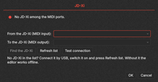</a> |

## 🚀 Download and install

The builds are on the [releases page](https://github.com/emanuelemerlo/JD-Xi-Studio/releases).
Windows, macOS and Linux each have their package; alpha, beta and release-candidate versions are
marked as pre-releases. The app checks that page for updates
(Help › Check for Updates).

### Windows 📦
Each release offers two downloads; take the one you want:
- the **installer** `JD-Xi-Studio-<version>-setup-win64.exe` (installs for the current user,
  no administrator rights, adds Start menu entries and an uninstaller);
- the **portable** `JD-Xi-Studio-<version>-win64-portable.zip` (nothing to install: unzip anywhere,
  even on a USB stick, and run `JD-Xi-Studio.exe`).

Windows 10 or 11, 64-bit. The files are not signed yet: if SmartScreen warns, choose
"More info" → "Run anyway".

### macOS 🍎
`JD-Xi-Studio-<version>-macos-arm64.dmg` (Apple silicon) or `…-macos-x86_64.dmg` (Intel): open
it and drag **JD-Xi Studio** onto **Applications**. macOS 11 or later. The app is not signed with a Developer ID
yet: the first time macOS stops it; then choose **Open Anyway** in System Settings › Privacy &
Security (more in the manual's Troubleshooting).

### Linux 🐧
`jd-xi-studio_<version>_amd64.deb` for Debian, Ubuntu, Mint and the like (Ubuntu 22.04 /
Debian 12 or later): `sudo apt install ./jd-xi-studio_<version>_amd64.deb`. It adds JD-Xi Studio
to the applications menu and the `jd-xi-studio` command.

### macOS and Linux: one command
For another Linux distribution (or to run from source), one command installs the newest release in its own Python environment and adds JD-Xi Studio to
the applications (the menu on Linux, `~/Applications` on macOS); nothing goes system-wide and no
`sudo` is needed:

```bash
curl -fsSL https://raw.githubusercontent.com/emanuelemerlo/JD-Xi-Studio/main/install.sh | bash
```

Run it again to update; `... | bash -s -- --uninstall` removes the app (settings and patches stay),
`--version v1.0.0-beta.1` installs a given release. It needs Python 3.10–3.13 and a few libraries
(PortAudio, ALSA on Linux; Homebrew's `portaudio` on macOS): when one is missing it stops and shows
the command to install it. The macOS part has not been
tried on a Mac yet: reports welcome.

### Python 🐍
Python 3.10 to 3.13, in a virtual environment. Each release also carries the wheel; or install
from GitHub, and start it with `jdxi-editor`:

```bash
python -m venv jdxi-env
source jdxi-env/bin/activate          # Windows: jdxi-env\Scripts\activate
python -m pip install "git+https://github.com/emanuelemerlo/JD-Xi-Studio.git"
jdxi-editor
```

The `JDXI-Editor` package on PyPI is the original project, not this one.
PyAudio needs the PortAudio library (macOS `brew install portaudio`, Debian/Ubuntu
`sudo apt install portaudio19-dev`) before the `pip install`.

## 🌍 Languages

The interface is in **English** and **Italiano**: choose it in **File › Preferences › Interface
language** ("Same as the system" follows the operating system; the change applies at the next start).
Parameter names (Cutoff, Resonance, Porta Time…) stay as on the JD-Xi's display and in Roland's
manuals, so what you read matches the instrument. To add a language, see
[jdxi_editor/i18n/README.md](jdxi_editor/i18n/README.md).

## 📖 Documentation

- [CHANGELOG.md](CHANGELOG.md): what changed in each version.
- [Features and usage](doc/features-and-usage.md): patch files (.jsz, .msz, .json, .syx), connection, saving on the JD-Xi.
- [Windows development](doc/dev-windows.md): Visual Studio, VS Code, local builds.
- [Developer tools](doc/dev-tools.md): MIDI analysis and transcription tools.
- The original project's documentation, which still describes the engine:
  https://markxbrooks.github.io/JDXI-Editor/

## 🛠 Development

```bash
git clone https://github.com/emanuelemerlo/JD-Xi-Studio.git
cd JD-Xi-Studio
python -m venv venv
source venv/bin/activate              # Windows: venv\Scripts\activate
python -m pip install -e ".[dev]"
python -m jdxi_editor.main
```

Tests: `pytest tests` (Qt runs off screen with `QT_QPA_PLATFORM=offscreen`). On GitHub they run on
Linux and Windows for every PR and push; macOS runs on its own every Monday night and on demand
(**Actions › macOS tests**): red is a real error, grey means no macOS runner came (retried
automatically, up to three times).
`python scripts/ui_audit.py` checks the interface without clicking every control (navigation,
buttons lit, text that does not fit, labels not centred). After changing interface strings run
`python -m building.i18n update`, translate the `.ts` files, then `python -m building.i18n compile`.
The pictures and icons are drawn by `python building/art/make_art.py`.

## 📦 Building

Windows: the app (PyInstaller, one folder) and the installer (Inno Setup 6):
```commandline
python -m pip install ".[build-windows]"   # not -e: the spec bundles the installed resources
cd %TEMP%
pyinstaller --noconfirm --clean --distpath <repo>\dist <repo>\building\windows\jdxi_editor.spec
cd <repo>
iscc /DMyAppVersion=<version> jdxi_editor.iss        # -> dist\installer\
```

macOS (disk image) and Linux (.deb), on that system (CI: **Actions › Desktop packages**):
```bash
python -m pip install . pyinstaller        # macOS: brew install portaudio first
cd /tmp && pyinstaller --noconfirm --clean --distpath <repo>/dist <repo>/building/desktop/jdxi_studio.spec
cd <repo> && python -m building.desktop.package dmg    # or: deb
```
`python -m building.buildsys` and the scripts in `building/apple` and `building/linux` come from
the original project and are not maintained here.

### Releasing

1. Set the version in `jdxi_editor/project.py` (`__version__ = "1.0.1"`, PEP 440; `"1.1.0rc1"`
   for a release candidate) and in `jdxi_editor.iss`, and add its section to `CHANGELOG.md`;
   merge into `main`.
2. **Actions › Release › Run workflow** on `main`. The workflow runs the tests, builds the Windows
   installer and portable app, the macOS disk images, the Linux .deb and the Python wheel, creates
   the tag (`v1.0.1`, or `v1.1.0-rc.1`) and the release (a pre-release for alpha, beta and rc),
   attaches every file and publishes it. macOS runners can be scarce: with no disk image at all
   nothing is published (re-run the failed jobs later); with one of the two, the release says
   which is missing.
3. Verify it on the instrument: [`doc/hardware-test-plan.md`](doc/hardware-test-plan.md) (the
   automatic part, with the app closed: `python scripts/hardware_check.py` and
   `pytest -m hardware tests/test_jdxi_checks.py`).

No tag to push by hand. The `Windows build` workflow still builds every push to `fix/**`,
`feature/**` and `release/**` branches (artifacts at the bottom of the run).

## 🙏 Credits

- **Emanuele Merlo**: JD-Xi Studio.
- **Mark Brooks**: the original [JDXI-Editor](https://github.com/markxbrooks/JDXI-Editor), on which
  JD-Xi Studio is based.
- [Qt / PySide6](https://www.qt.io/), [Mido](https://mido.readthedocs.io/),
  [RtMidi](https://www.music.mcgill.ca/~gary/rtmidi/), [qtawesome](https://github.com/spyder-ide/qtawesome).
- **Roland**, for such a powerful little synth.

Issues and ideas: [GitHub Issues](https://github.com/emanuelemerlo/JD-Xi-Studio/issues).

---

JD-Xi Studio is an independent, unofficial tool, not affiliated with, endorsed or sponsored by Roland
Corporation. Roland and JD-Xi are trademarks of Roland Corporation in the United States and/or other
countries. Licensed under the [MIT License](LICENSE).
