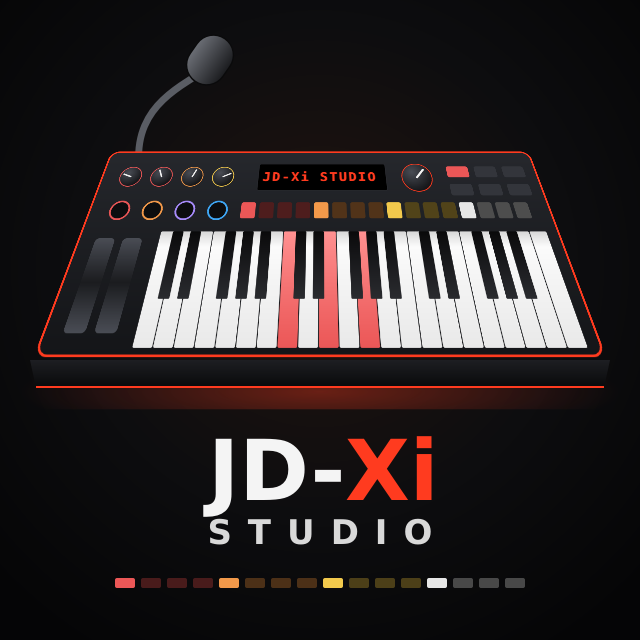
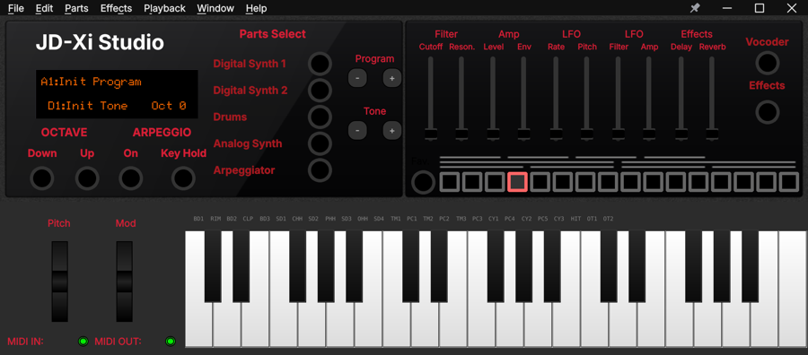

JD-Xi Studio
============

**JD-Xi Studio** is an editor and librarian for the **Roland JD-Xi** synthesizer: every sound, the
pattern sequencer, the effects and the vocoder, on the computer screen instead of the JD-Xi's menus.

.. note::
   JD-Xi Studio is developed by **Emanuele Merlo**. It is an independent edition of
   `JDXI-Editor <https://github.com/markxbrooks/JDXI-Editor>`_ by **Mark Brooks**, on which it is
   based (MIT licence). The README on GitHub has the full description, the screenshots and how to
   install it: https://github.com/emanuelemerlo/JDXI-Editor

Download
--------
The builds are on the `releases page <https://github.com/emanuelemerlo/JDXI-Editor/releases>`_:
for Windows an installer (``jdxi_editor-<version>_setup_win_x86-64.exe``, for the current user,
no administrator rights) and a portable zip, plus the Python wheel. On macOS and Linux install the
wheel with Python 3.10 to 3.13 and start it with ``jdxi-editor``.

Credits
-------
- **Emanuele Merlo**: JD-Xi Studio.
- **Mark Brooks**: the original `JDXI-Editor <https://github.com/markxbrooks/JDXI-Editor>`_.
- `Qt / PySide6 <https://www.qt.io/>`_, `Mido <https://mido.readthedocs.io/>`_,
  `RtMidi <https://www.music.mcgill.ca/~gary/rtmidi/>`_.

JD-Xi Studio is an independent, unofficial tool, not affiliated with, endorsed or sponsored by Roland
Corporation. Roland and JD-Xi are trademarks of Roland Corporation. MIT License.
