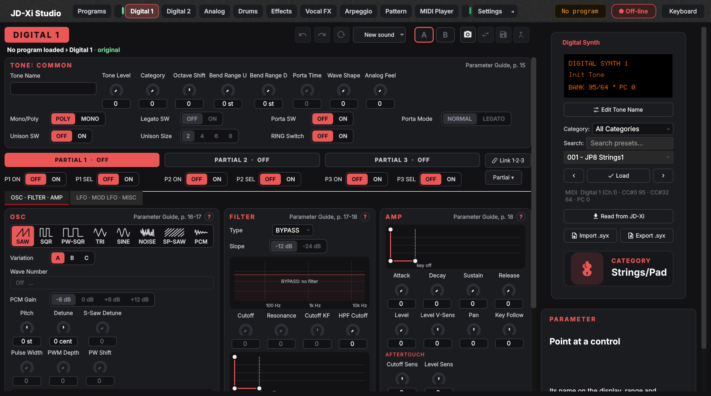

Digital Synth Editors (Parts 1 & 2)
====================================

The **Digital Synth Editors** provide comprehensive control over the JD-Xi's digital synthesis engines, offering unprecedented access to the synthesizer's multi-partial architecture. These powerful editors transform your JD-Xi's digital synthesis capabilities into a professional-grade sound design workstation.

Built with advanced Qt6 technology and featuring real-time parameter control, the Digital Synth Editors serve as your primary workspace for creating, editing, and managing sophisticated digital sounds with the precision and control of modern software synthesizers.

What are the Digital Synth Editors?
===================================

The Digital Synth Editors are specialized interfaces that provide deep, granular control over the JD-Xi's digital synthesis engines. Unlike the limited hardware interface, these editors offer expansive, visual control over every parameter with real-time feedback, advanced organization tools, and professional-grade editing capabilities.

Each editor represents a dedicated workspace optimized for digital sound design, from basic oscillator control to complex multi-partial synthesis. The editors automatically synchronize with your JD-Xi hardware, ensuring that every change is instantly reflected in your synthesizer's sound.

Core Architecture & Design
===========================

** Multi-Partial Architecture**
   The Digital Synth Editors feature a sophisticated multi-partial system:
   - **3 Partial Control**: Individual control over each of the 3 partials per digital synth
   - **Layer Blending**: Sophisticated mixing and blending of multiple partials
   - **Cross-Modulation**: Advanced modulation routing between partials
   - **Real-time Visualization**: Live display of partial relationships and interactions

** Advanced Parameter Management**
   - **Comprehensive Parameter Mapping**: Every digital synth parameter is accessible through intuitive controls
   - **Real-time Updates**: Instant parameter changes with immediate hardware response
   - **Visual Feedback**: Live parameter displays, value indicators, and status monitoring
   - **Preset Integration**: Seamless loading, saving, and management of your custom sounds

** Professional Workflow Tools**
   - **Multi-Editor Support**: Work with both digital synth parts simultaneously
   - **Advanced Organization**: Categorize, search, and manage your sound library
   - **Project Integration**: Export and import settings for use in your DAW
   - **Performance Optimization**: Low-latency response for live performance and recording

Digital Synth Editor Features
=============================

**Oscillator Control**
   Advanced waveform and frequency control:

   **Waveform Selection**
      - **Multiple Waveforms**: Access to all JD-Xi digital waveforms
      - **Waveform Preview**: Real-time visualization of selected waveforms
      - **Custom Waveforms**: Support for user-defined waveforms
      - **Waveform Morphing**: Smooth transitions between waveforms

   **Frequency Control**
      - **Pitch Control**: Precise pitch adjustment and tuning
      - **Detune Control**: Fine-tuning for detuned effects
      - **Pitch Modulation**: LFO and envelope modulation of pitch
      - **Frequency Modulation**: Advanced FM synthesis capabilities

**Filter Processing**
   Sophisticated filtering with multiple modes:

   **Filter Types**
      - **Low-Pass Filter**: Traditional low-pass filtering
      - **High-Pass Filter**: High-frequency emphasis
      - **Band-Pass Filter**: Frequency band isolation
      - **Multi-Mode Filter**: Switchable filter types

   **Filter Parameters**
      - **Cutoff Frequency**: Real-time cutoff control
      - **Resonance**: Filter emphasis and character
      - **Envelope Modulation**: ADSR control of filter parameters
      - **LFO Modulation**: Low-frequency oscillator modulation

**Envelope Shaping**
   Complete ADSR control with additional stages:

   **ADSR Controls**
      - **Attack**: Initial sound onset control
      - **Decay**: Initial decay after attack
      - **Sustain**: Sustained level control
      - **Release**: Final decay control

   **Additional Envelope Stages**
      - **Hold**: Sustain level holding
      - **Delay**: Pre-attack delay
      - **Additional Decay**: Multi-stage decay
      - **Envelope Scaling**: Time and level scaling

**Effects Processing**
   Built-in effects optimized for digital synthesis:

   **Effect Types**
      - **Distortion**: Harmonic enhancement and saturation
      - **Chorus**: Stereo width and movement
      - **Delay**: Time-based effects and echoes
      - **Reverb**: Spatial effects and ambience

   **Effect Parameters**
      - **Real-time Control**: Live parameter manipulation
      - **Effect Routing**: Flexible effect chain routing
      - **Preset Management**: Save and recall effect settings
      - **Performance Integration**: Optimized for live performance

Working with the Three Partials
===============================

A SuperNATURAL synth tone has three partials. **PARTIAL 1 / 2 / 3** chooses the one shown;
under each, **P ON** turns it on or off and **P SEL** says whether the panel knobs edit it (the
[05]–[07] and [01]–[03] buttons of the JD-Xi). Above them:

**Link 1·2·3**
   It links the three partials of this part (not Digital 1 with Digital 2). When it is on, a change to the partial shown is made on the other partials that are on too
   (the value you set, not a shift: Cutoff 80 is 80 on all of them), in one Undo step. The
   oscillator stays each partial's own: waveform, variation, PCM wave and gain, pitch, detune and
   Super Saw detune. It is off when the editor opens.

**Partial ▾**
   On the partial shown:

   - **Copy partial**, or **Copy section** (Oscillator, Filter, Amplifier, LFO, Modulation LFO);
   - **Paste into partial**: what was copied, also from the other Digital part (the copy is shared
     by Digital 1 and Digital 2); the menu says what it is (*Filter of Digital 1 · partial 2*);
   - **Swap with partial** 1, 2 or 3;
   - **Randomize…**: a section of the partial, the partial or the whole tone (the three partials,
     Wave Shape and Analog Feel), by a little (each value moves by up to 10% of its range), a
     medium amount (30%) or much (anything, also the waveforms, filter types and LFO shapes). The
     name, category, playing style and which partials are on stay; a partial stays audible.

   Each of these is one Undo step.

**PCM waves**
   With the waveform **PCM**, **Wave Number** opens the list of the 160 waves by family (Synth &
   Lead, Bass, Bell & Metallic, Voice & Formant, Pad & Strings, FX & Noise, Hit & Drum, Keys &
   Organ, Guitar, Brass & Wind, Ethnic), with a search by name or number and ★ favourites. With
   **Try** on, each wave chosen is set on the partial and plays a short C4 on the part's channel:
   the arrow keys go through the waves by ear. Cancel puts the wave back; OK keeps the one chosen
   (one Undo step).

**Envelope loop**
   With *Loop Mode* (MISC) set to FREE-RUN or TEMPO-SYNC, the filter and amplifier envelopes show
   the attack and decay starting again while the key is held, with *loop* (or *loop 1/4*, the
   Sync Note).

**Take from A or B**
   In the top bar, after the A/B photos and the disk, the button with two arrows joining lists the sections where a photo differs
   from the current sound (*FILTER P1: 3 different*): tick the ones to bring in, the rest stays as
   it is. One Undo step takes them back. It also works in the Analog editor.

Performance Features
====================

**Live Parameter Control**
   Real-time manipulation of all synthesis parameters:

   **Real-time Updates**
      - **Instant Response**: Immediate parameter changes
      - **Smooth Transitions**: Gradual parameter changes
      - **MIDI Control**: External controller integration
      - **Automation**: Parameter automation support

   **Performance Modes**
      - **Live Mode**: Optimized for real-time performance
      - **Edit Mode**: Detailed parameter editing
      - **Preset Mode**: Quick preset switching
      - **Learn Mode**: MIDI controller learning

**Preset Management**
   Advanced organization and recall of your custom sounds:

   **Preset Organization**
      - **Categories**: Organize presets by type or style
      - **Tags**: Add custom tags for easy searching
      - **Favorites**: Mark frequently used presets
      - **Recent**: Quick access to recently used presets

   **Preset Operations**
      - **Save**: Save current settings as preset
      - **Load**: Load existing presets
      - **Copy**: Duplicate existing presets
      - **Delete**: Remove unwanted presets

**MIDI Integration**
   Full support for external MIDI controllers and keyboards:

   **Controller Support**
      - **MIDI Learn**: Assign any parameter to any controller
      - **Controller Mapping**: Save and recall controller mappings
      - **Multiple Controllers**: Support for multiple MIDI controllers
      - **Controller Profiles**: Different profiles for different setups

   **Keyboard Integration**
      - **Note Input**: Play notes using MIDI keyboard
      - **Velocity Sensitivity**: Respond to playing dynamics
      - **Aftertouch**: Support for pressure sensitivity
      - **Pitch Bend**: Pitch bend wheel support

Visual Feedback & Monitoring
============================

**Real-time Visualization**
   Live display of waveforms, envelopes, and parameter relationships:

   **Waveform Display**
      - **Live Waveforms**: Real-time waveform visualization
      - **Spectrum Analysis**: Frequency domain display
      - **Waveform Comparison**: Compare different waveforms
      - **Custom Waveforms**: Display user-defined waveforms

   **Envelope Visualization**
      - **ADSR Display**: Visual representation of envelope stages
      - **Envelope Editing**: Graphical envelope editing
      - **Envelope Comparison**: Compare different envelopes
      - **Envelope Automation**: Visual automation display

**Parameter Monitoring**
   Comprehensive display of current settings and parameter relationships:

   **Value Displays**
      - **Numerical Values**: Precise parameter values
      - **Bar Graphs**: Visual parameter levels
      - **Meters**: Real-time level monitoring
      - **Status Indicators**: Parameter state indicators

   **Relationship Display**
      - **Modulation Matrix**: Visual modulation routing
      - **Signal Flow**: Audio signal path display
      - **Parameter Dependencies**: Show parameter relationships
      - **Effect Chain**: Visual effects routing

Getting Started with Digital Synth Editors
==========================================

**Initial Setup**
   1. **Launch Digital Synth Editor**: Open the Digital Synth Editor from the main interface
   2. **Select Part**: Choose Digital Synth Part 1 or Part 2
   3. **Load a Preset**: Start with a factory preset to understand the interface
   4. **Explore Controls**: Familiarize yourself with the available parameters and controls

**Basic Workflow**
   1. **Choose a Partial**: Select which partial to edit (1, 2, or 3)
   2. **Adjust Parameters**: Use sliders, knobs, and controls to modify settings
   3. **Test Your Changes**: Play notes using the virtual keyboard or MIDI controller
   4. **Save Your Work**: Use the preset management system to save your creations

**Advanced Techniques**
   - **Multi-Partial Workflow**: Use multiple partials for complex sound design
   - **Cross-Modulation**: Create complex modulation relationships between partials
   - **Layer Blending**: Blend multiple partials for rich, complex sounds
   - **Performance Integration**: Optimize the interface for live performance

**Tips for Effective Sound Design**
   - **Start Simple**: Begin with basic waveforms and simple envelopes
   - **Layer Gradually**: Add complexity by layering multiple partials
   - **Use Modulation**: Experiment with LFO and envelope modulation
   - **Save Frequently**: Save your work regularly to avoid losing changes

The Digital Synth Editors transform your Roland JD-Xi's digital synthesis capabilities into a professional-grade sound design workstation, providing the tools and interface you need to create, edit, and manage sophisticated digital sounds with the precision and control of modern software synthesizers.

   Digital Synth 1 - Multi-Partial Interface
