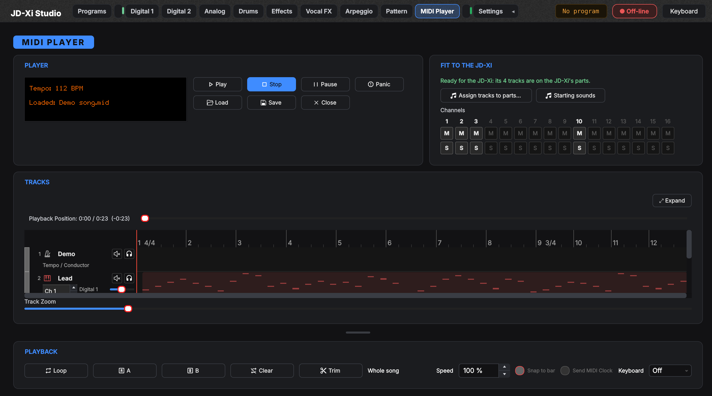

MIDI Player
===========

The **MIDI Player** plays MIDI files on the Roland JD-Xi: it says which of a file's tracks the
JD-Xi plays, helps put them on its four parts, and records the JD-Xi's USB audio while it plays.

What the JD-Xi plays
====================

The JD-Xi plays four parts, each on its own channel: **Digital 1** (1), **Digital 2** (2),
**Analog** (3) and **Drums** (10). Notes on any other channel are not heard. A file made for the
JD-Xi plays as it is; a general MIDI file (an orchestra on 16 channels) has to be fitted first.

Fit to the JD-Xi
================

* A line says what of the file the JD-Xi plays: *Ready for the JD-Xi*, or for example
  *28 of 44 tracks are on channels no JD-Xi part plays: they are not heard*.
* **Assign tracks to parts…** proposes a part for each track that plays notes, in a table you
  can change before **Apply**: the drum tracks to Drums; for each melodic part the one track
  recognised best for it — the bass to Digital 1, keys or guitars to Digital 2, strings to Analog
  (the Analog part plays one note at a time); the other tracks are not played. A track's channel
  can also be set by hand in its header.
* **Starting sounds** gives the parts a sound to start from, also written into the file:
  Digital 1 Picked Bass, Digital 2 Piano, Analog JP8 Strings.
* The mute buttons of channels 1, 2, 3 and 10 stand out; their tooltip says which part plays them.

The file on disk changes only when you save it.

Tracks
======

* One row per track: name (when the file has none, the instrument it plays, in grey), channel,
  part, mute, solo, velocity scale, and its notes on the time line.
* **Expand** hides the cards not needed while listening (Fit to the JD-Xi, Automation,
  USB recorder, Event filter) so the tracks take the room; Player and Playback stay.
  **Restore** brings them back.
* The grip under the Tracks card sets its height (remembered; double click: the usual height).
* Loading a big file shows its progress on the player's display (*Loading: track 12 of 45*).

Playback
========

* Play, Pause, Stop, Panic; speed in percent of the file's tempo.
* **Loop** repeats the A–B range, or the whole song when none is set. **A** and **B** take the
  playback position (snapped to bars if chosen); A shows on the ruler at once, the range when B
  is set. **Trim** keeps only a part of the file.
* **Event filter**: the file's program changes (PC) and controllers (CC) can be kept from the
  JD-Xi.

USB recorder
============

The JD-Xi is also a USB audio interface. With **Record on every Play**, every Play records its
audio into a WAV (stereo, 16 bit) until 10 seconds after the song ends; in a playlist, one WAV per
song. The port list shows only the inputs that can record, and the JD-Xi's is chosen by itself.

Pattern Sequencer
=================

The Pattern imports the file opened here when it is shown, its first 64 bars (a pattern, not a
whole song).

Formats: Standard MIDI Files (.mid, .midi), types 0 and 1.

   The MIDI Player
