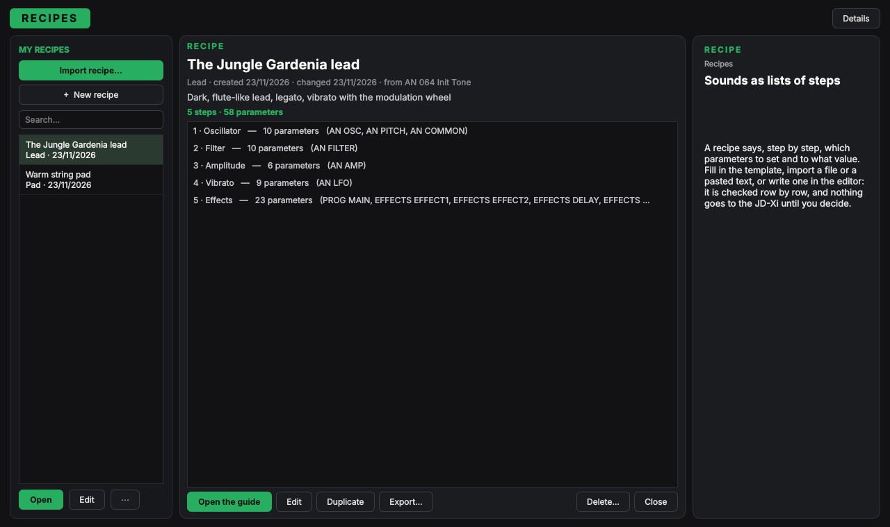
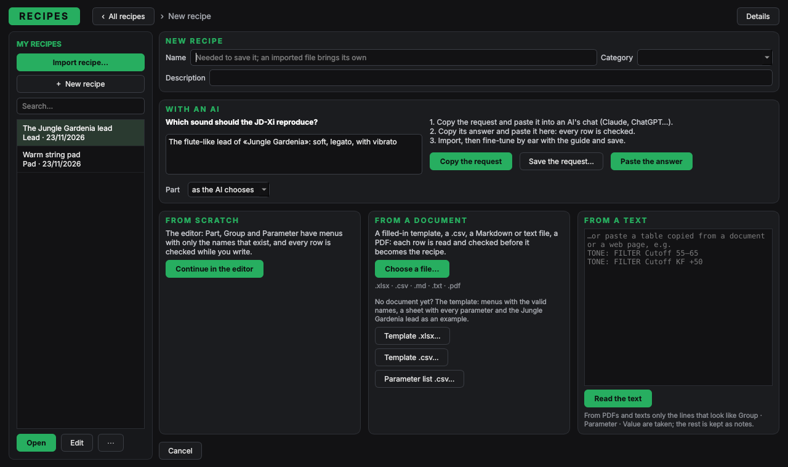
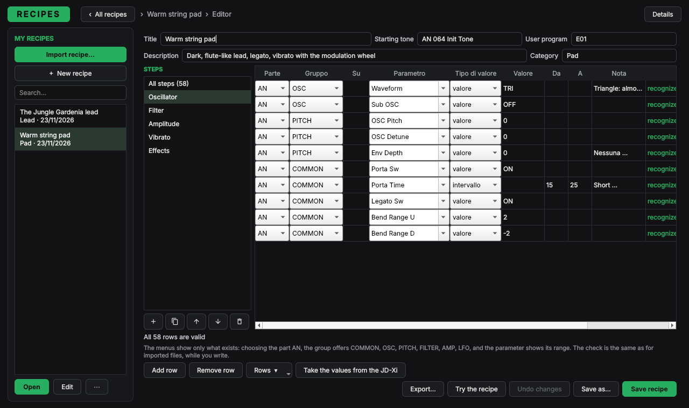

Recipes
=======

A recipe says, step by step, which parameters of the JD-Xi to set and to what value to get a
sound. Recipes are meant to be **written by an AI** from a description of the sound, then
**fine-tuned by ear**: JD-Xi Studio prepares the request for the AI, reads its answer, checks
every row against the JD-Xi's real parameters and guides you through the steps on the instrument.

Everything happens in the **Recipes** tab, in three areas: the library on the left, the work in
the middle, the explanation of what is chosen on the right (**Details** shows or hides it).

The library
-----------

* **Import recipe…** — the usual start: the file an AI filled in (or the template filled in by
  hand), a ``.csv``, a Markdown or text file, a PDF.
* **+ New recipe** — with an AI, from scratch, from a document or from a pasted text.
* **Search** by title, category or description. Each recipe shows its category and the day it
  was last changed.
* **Open** (the guide), **Edit**, and under **⋯** or a right click: **Duplicate**, **Export…**,
  **Delete…** (asked first), **Close** (back to the start, no recipe chosen).

Choosing a recipe shows it in the middle: its description, its steps, how many parameters,
when it was created and changed.

With an AI
----------

1. **New recipe › With an AI**: describe the sound to reproduce («the flute-like lead of
   *Jungle Gardenia*: soft, legato, with vibrato») and choose the part — Digital 1, Digital 2,
   Analog, Drums — or let the AI choose.
2. **Copy the request** and paste it into an AI's chat (Claude, ChatGPT…), or **Save the
   request…** to attach it. The request carries the sound, the exact format (the template's
   columns, a CSV), the rules — only the parameter names JD-Xi Studio knows, values within their
   range or among their choices, *value* / *range* / *by ear*, starting from the part's Init
   Tone, steps in the order they are set on the instrument, a reason per row — an example and
   the list of the part's parameters with their ranges and choices.
3. Copy the AI's answer and **Paste the answer** (or import the file it gives you). The CSV is
   taken out of the answer, every row checked.
4. In the check, confirm or correct what was not understood, then **Import the recipe**.
5. Open the guide, set the steps on the JD-Xi, **fine-tune by ear**, then in the editor **Take
   the values from the JD-Xi** and save.

The name can wait: it is needed only to save the recipe (an imported file brings its own).

The check
---------

Every row read from a file, a text or an AI's answer is shown as read and as understood:
*recognised* (ready), *to confirm* (a probable meaning: choose it), *to fix* (not a parameter, or
a value out of range), *by ear* (set by listening, not automatically). Rows that are not a
parameter are kept as notes. Nothing reaches the JD-Xi until you set it.

The editor
----------

* **Steps** on the left, in the recipe's order: double-click to rename; add, duplicate, move up
  or down, delete. **All steps** shows the whole recipe.
* The chosen step's **rows**: Part, Group and Parameter have menus with only the names that
  exist; the Check column says at once whether a row is understood. **Add row** (in the step),
  **Remove row**, and under **Rows ▾**: duplicate, move, **copy** (Ctrl+C) and **paste**
  (Ctrl+V) — rows copied here, from a sheet or from an AI's answer go into the chosen step: ask
  the AI to redo only the filter and paste those rows.
* The chosen row's parameter is explained on the right: what it does, its range or choices.
* **● not saved** in the line at the top; **Undo changes** goes back to the recipe as saved;
  **Save as…** keeps the one opened as it was.
* **Take the values from the JD-Xi** writes in each row the value the parameter has now — after
  fine-tuning on the instrument, or to write a recipe from a sound.

The guide
---------

Step by step, the recipe's value next to the JD-Xi's: set one row or all those missing in a
step, listen, go on. The JD-Xi keeps a sound only when you save the program with
**[Menu/Write]** on the instrument; a recipe can suggest which user program.

The template
------------

**New recipe › From a document** offers the template (``.xlsx`` with menus of the valid names,
or ``.csv``) and the list of all the parameters (``.csv``). Columns: Step, Step name, Part,
Group, Target, Parameter, Value type, Value, From, To, Note; header lines carry the title,
description, author, starting tone and user program. Italian and English templates are both read.
