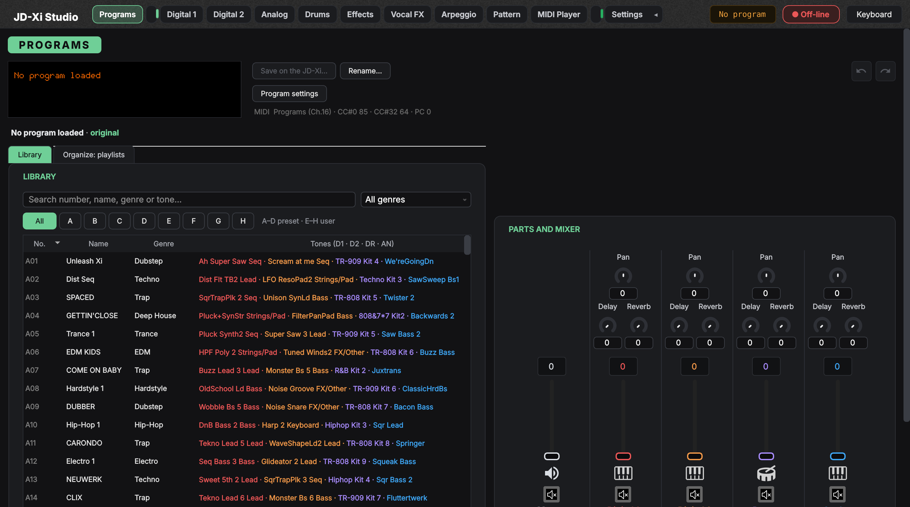

What's New in 1.0.0 rc 1
========================

The release candidate: the MIDI Player fits a file to the JD-Xi, the state shown is closer to what
the JD-Xi really holds, and FluidSynth is gone.

MIDI Player
-----------

* The «MIDI file» tab is the **MIDI Player**.
* **Fit to the JD-Xi** says which of the file's tracks the JD-Xi plays; **Assign tracks to
  parts…** proposes a part for each (drums, then one track each for Digital 1, Digital 2, Analog),
  to check and apply. **Starting sounds** gives the parts a sound to start from.
* Big files load in seconds, with their progress on the display; the Pattern imports the file when
  shown, its first 64 bars.
* Tracks: **Expand** for more room, a grip for their height; a track without a name shows the
  instrument it plays. The loop's A point shows as soon as it is set.
* USB recorder: **Record on every Play**, now in stereo, on the JD-Xi's input.

Programs
--------

* Playlist: Add / Remove over the songs, Play, Stop, Pause and **Mix** in a compact row; the
  **Extra sound** column (a Digital preset on the Analog part) readable.

What the JD-Xi holds
--------------------

* A typed name is an edit (one Undo, «Modified»).
* Save on the JD-Xi asks before writing in a slot whose content is not known.
* A tone change on one part forgets only that part; a message the port refuses is not counted as
  held.

Also: picomidi 0.3 (a muted track no longer cuts a note another track holds).

Removed: the FluidSynth software synth and the SoundFont preset lists (they played General MIDI
sounds, not the JD-Xi's, and only for notes coming from a MIDI keyboard).

What's New in 1.0.0 beta 2
==========================

**Visual Sound Design, Editing & Librarian for the Roland JD-Xi.** This beta makes the work with
the instrument safer and easier to follow: the app always says whether the JD-Xi is there, what it
holds, and what is saved where.

.. note::

   These features were tried on a simulated JD-Xi; the checks on the real instrument are listed in
   ``doc/hardware-test-plan.md`` (the automatic part: ``pytest -m hardware tests/test_jdxi_checks.py``).

Connection and Off-line
-----------------------

* The JD-Xi counts as **connected only once it answers as a JD-Xi** (a port named "JD-Xi" is not
  enough). The state shows as a badge: under MIDI IN / OUT in the keyboard window, at the top right
  of the editors window, in the corner of the other windows: **Off-line**, **Verifying the
  JD-Xi…**, **connected**, **Unstable connection**.
* Off-line everything can be tried, nothing is sent or saved: the commands that need the JD-Xi are
  off, with the reason in their tooltip. A warning says so once, after the start screen.
* When the JD-Xi arrives after changes made without it, they are given up for what it holds;
  **Save as file…** in that notice keeps them first.

When the JD-Xi comes back
-------------------------

After a disconnection (cable out, switched off and on) everything is read again and compared with
what the JD-Xi confirmed before:

* the same: «Reconnected»;
* different, with changes not saved anywhere: the parts that differ, and **Restore on the JD-Xi**
  or **Keep what the JD-Xi has** (a restore is read back part by part);
* different, with nothing at risk: the JD-Xi's settings are shown.

Where you are
-------------

A line under each editor's header and on the Programs page:
*program › part › tone · origin · state*. The origin is where the part's sound came from (a
program, a preset, a recipe, a file, an A/B photo, Init); the state is *original*, *modified,
temporary* (sent, not kept), *modified, not sent* (Off-line), *saved to file*, *saved in E-12*.

Save on the JD-Xi
-----------------

The JD-Xi keeps a program only with its WRITE, in the user banks E–H. **Programs › Save on the
JD-Xi…** guides it: name the program, choose the slot (slots named «Init Program» are proposed as
probably free, a slot with a program asks first), press WRITE on the JD-Xi as shown, then **Done**:
the app selects the slot and reads it back. «Saved in E-12 ✓» appears only when the slot holds the
sound.

New sound and section help
--------------------------

* **New sound ▾** in the Digital and Analog editors: *From scratch (Init)* — this part's tone
  only, a plain sawtooth with the filter open; one Undo brings the sound back — *From a preset*,
  *From a recipe*.
* A **?** on OSC, FILTER, AMP, LFO, PITCH, the effects, delay and reverb: what the section changes,
  how the sound changes, an example, in the information panel.

Programs
--------

   The Programs page: the library on the left, the parts inside the mixer on the right.

* The library searches number, name, genre and the four tones, sorts by number, name or genre,
  marks the program loaded on the JD-Xi apart from the one selected, and shows the tones in their
  parts' colours; right click: Load, Rename, Genre, Add to playlist, Export.
* The parts are inside the mixer: above each fader the part's Pan and its Delay and Reverb sends,
  under it the part's tone (click: choose another), its MIDI channel and Edit; parts in their tabs'
  colours, the Master neutral, a box to type a level. The sends are off where the part's output
  skips that effect.
* **Program settings** (the button beside Rename, or Editor › Program settings), right after
  Programs: what the program keeps besides its tones, part by part — level, pan, effects, pitch,
  offsets, zones, scale and MIDI. The mixer's Pan and sends are the same values.
* Organize: the playlists (factory programs too) and the selected one's programs.

A/B compare and recipes
-----------------------

* A/B compare (Digital 1, Digital 2, Analog): two photos of a tone, recalled and checked by reading
  it back; a photo taken without the JD-Xi whose data is not all known cannot be recalled.
* A recipe step is one Undo, also when it sets several editors.
